<!-- ===================== HEADER ===================== -->

  

  
  

  
  
  

---

##  About Me

  

   <b>M.Sc. Data Science @ VIT</b> &nbsp;•&nbsp;
   <b>Chennai, India</b> &nbsp;•&nbsp;
   <b>Open to AI/ML & GenAI roles</b>

---

##  Tech Stack

<b>Languages & Databases</b>

  

<b>AI · ML · Data</b>

  
   
  
  
  
  
  
  
  

<b>Web · APIs · Tools</b>

  

<b>🧠 Full skill breakdown (click to expand)</b>

 

| Area | Skills |
|---|---|
| 🤖 **Generative AI** | LLMs, RAG, AI Agents, Prompt Engineering, Vector Databases, LLM App Development |
| 💬 **NLP** | Text Classification, Sentiment Analysis, NER, Topic Modeling, Feature Extraction |
| 👁️ **Computer Vision** | Image Classification, Object Detection, OpenCV, Image Processing |
| 🧬 **Deep Learning** | ANN, CNN, Deep Learning Fundamentals |
| 📈 **Machine Learning** | Supervised & Unsupervised Learning, Ensembles, Hyperparameter Tuning, Model Evaluation |
| 📊 **Data Science** | EDA, Data Cleaning, Statistics, Feature Engineering, Predictive Analytics, BI |
| ☁️ **Deployment** | Render, GitHub Pages, REST APIs, Model Deployment |

---

##  Featured Repositories

  
  
  
  
  
  
  
  

<b> More AI projects (click to expand)</b>

 

  
  
  
  
  
  

  

---

##  AI Arcade

<i>Little AI agents playing games: on a game board, and on my contribution graph.</i>

  
  

<b>👻 Pac-Man AI eating my contributions</b>

  <picture>
    <source media="(prefers-color-scheme: dark)" srcset="https://raw.githubusercontent.com/Neelimapasala/Neelimapasala/output/pacman-contribution-graph-dark.svg">
    <source media="(prefers-color-scheme: light)" srcset="https://raw.githubusercontent.com/Neelimapasala/Neelimapasala/output/pacman-contribution-graph.svg">
    
  </picture>

<b>🕹️ More contribution games: Snake · Galaga · Breakout · Tetris (click to expand)</b>

 

<b>🐍 Snake</b>

  <picture>
    <source media="(prefers-color-scheme: dark)" srcset="https://raw.githubusercontent.com/Neelimapasala/Neelimapasala/output/github-snake-dark.svg" />
    <source media="(prefers-color-scheme: light)" srcset="https://raw.githubusercontent.com/Neelimapasala/Neelimapasala/output/github-snake.svg" />
    
  </picture>

<b>🚀 Galaga</b>

  

<b>🧱 Breakout</b>

  <picture>
    <source media="(prefers-color-scheme: dark)" srcset="https://raw.githubusercontent.com/Neelimapasala/Neelimapasala/output/breakout-contribution-graph-dark.svg">
    
  </picture>

<b>🟪 Tetris</b>

  <picture>
    <source media="(prefers-color-scheme: dark)" srcset="https://raw.githubusercontent.com/Neelimapasala/Neelimapasala/output/tetris-contribution-graph-dark.svg">
    
  </picture>

---

##  GitHub Stats

  
  

  

  

---

##  Certifications

  
  
  

---

##  Connect With Me

  
  
  
  

  
  <i>"Transforming data into intelligence and ideas into impactful AI solutions."</i>
  

  

